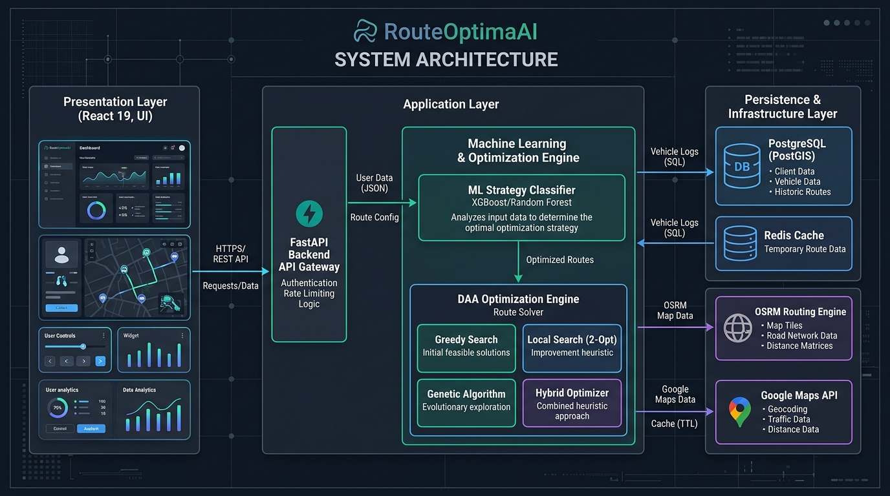

# RouteOptimaAI — System Architecture

> **AI-Based Complexity-Aware Delivery Route Optimization System**  
> *Production-Style Software Engineering System Architecture Blueprint*

---

## 1. System Architecture Flowchart

```mermaid
%%{init: {
  'theme': 'dark',
  'themeVariables': {
    'darkMode': true,
    'background': '#0e1117',
    'primaryColor': '#1e222b',
    'primaryTextColor': '#ffffff',
    'primaryBorderColor': '#4a5568',
    'lineColor': '#718096',
    'secondaryColor': '#161920',
    'tertiaryColor': '#2d3748',
    'fontFamily': 'Inter, system-ui, sans-serif'
  }
}}%%

flowchart LR
    %% User & Presentation
    User["User: orders CSV or config"] -->|upload & configure| Frontend["React + Vite frontend"]
    Frontend -->|history & filters| BrowserStorage[("Browser localStorage")]
    Frontend -->|POST /api/orders/import| Backend["FastAPI backend"]
    Frontend -->|POST /api/optimization/run| Backend
    Frontend -->|POST /api/simulation/start| Backend
    Backend -->|WebSocket /ws/live| Frontend
    Backend -->|structured JSON result| Frontend

    %% Backend Subsystems Branching
    Backend -->|geocode address| GeocodeRouter["Geocoding router"]
    Backend -->|extract 8 features| ComplexityBuilder["Complexity feature builder"]
    Backend -->|select & execute| DAAEngine["DAA optimization engine"]
    Backend -->|driving road geometry| RoutingService["Routing & distance service"]
    Backend -->|background loop| SimEngine["Asyncio simulation engine"]
    Backend -->|SQLAlchemy ORM| DBStorage[("SQLite database delivery.db")]

    %% Geocoding Branch
    GeocodeRouter -->|local match| PuneDict[("Local Pune dictionary - 40+ areas")]
    GeocodeRouter -->|PIN match| PunePIN[("Pune PIN code map - 25+ PINs")]
    GeocodeRouter -->|remote query| NominatimAPI["Nominatim OSM API"]
    GeocodeRouter -->|unresolved| StrictFail["Strict validation - status FAILED"]

    %% Complexity & ML Strategy Classifier Branch
    ComplexityBuilder -->|normalized vector| MLClassifier["ML strategy classifier"]
    MLClassifier -->|model configured| RFModel[("Random Forest - model.joblib 85%")]
    MLClassifier -->|fallback mode| RuleHeuristics["Deterministic heuristics"]
    MLClassifier -->|predicted strategy| StratArbiter["Safety & feasibility arbiter"]

    %% Strategy Arbiter Dispatches to DAA Solvers
    StratArbiter -->|selected strategy| DAAEngine

    %% DAA Optimization Solvers
    DAAEngine -->|orders <= 6 or low complexity| GreedySolver["Greedy nearest neighbor"]
    DAAEngine -->|moderate complexity / 2-opt| LocalSearchSolver["Local search - 2-Opt & relocation"]
    DAAEngine -->|high complexity / genetic| GeneticSolver["Genetic algorithm - Order Crossover"]
    DAAEngine -->|score >= 75 & orders >= 25| HybridSolver["Hybrid optimizer - GA + 2-Opt"]

    %% Solver Solutions to Route Evaluator
    GreedySolver -->|candidate solution| RouteEvaluator["Route evaluator & constraint checks"]
    LocalSearchSolver -->|candidate solution| RouteEvaluator
    GeneticSolver -->|candidate solution| RouteEvaluator
    HybridSolver -->|candidate solution| RouteEvaluator

    %% Constraint Checks
    RouteEvaluator -->|validate capacity| CapCheck["Vehicle capacity limit check"]
    RouteEvaluator -->|validate arrival vs end| TWCheck["Time window & lateness check"]
    RouteEvaluator -->|order coverage| CoverageCheck["Zero unassigned & duplicate check"]

    %% Routing & OSRM Branch
    RoutingService -->|sub-millisecond matrix| MatrixBuilder["Haversine 1.3x matrix builder"]
    RoutingService -->|turn-by-turn road polyline| OSRMClient["OSRM routing engine"]
    OSRMClient -->|HTTP GET /route/v1/driving| OSRMAPI["External OSRM public API"]
    RoutingService -->|cached road segments| RoutingCache[("routing_cache table")]

    %% Simulation Engine Branch
    SimEngine -->|segment interpolation| TelemetryGen["Live GPS telemetry generator"]
    TelemetryGen -->|broadcast position| WSManager["WebSocket connection manager"]
    WSManager -->|live vehicle coords| Frontend
    TelemetryGen -->|persist location audit| LocHistory[("vehicle_locations table")]

    %% Database Entities
    DBStorage --- OrdersTable[("orders table")]
    DBStorage --- VehiclesTable[("vehicles table")]
    DBStorage --- RoutesTable[("routes & route_stops")]
    DBStorage --- RunsTable[("optimization_runs & metrics")]
    DBStorage --- ModelsTable[("model_versions table")]

    %% Styling
    classDef default fill:#161920,stroke:#4a5568,stroke-width:1.2px,color:#ffffff;
    classDef cylinderNode fill:#1c212d,stroke:#5a67d8,stroke-width:1.5px,color:#e2e8f0;
    classDef highlightNode fill:#1a2332,stroke:#3182ce,stroke-width:1.5px,color:#ffffff;
    classDef warningNode fill:#2d1519,stroke:#e53e3e,stroke-width:1.2px,color:#feb2b2;

    class BrowserStorage,PuneDict,PunePIN,RFModel,RoutingCache,LocHistory,DBStorage,OrdersTable,VehiclesTable,RoutesTable,RunsTable,ModelsTable cylinderNode;
    class Frontend,Backend,DAAEngine,MLClassifier,RoutingService,SimEngine highlightNode;
    class StrictFail warningNode;
```

---

## 2. Visual Architecture Diagram

---

## 3. Architecture Layers & Data Flow Summary

### Layer 1: Presentation & Dispatcher
- **Actor:** `User: orders CSV or config` uploads orders via CSV or inputs delivery parameters.
- **Frontend:** `React + Vite frontend` (`frontend/src/`) provides the responsive dashboard, interactive Leaflet delivery map, and fleet controls.
- **Storage:** `Browser localStorage` caches UI filter preferences, active vehicle selections, and map view states.

### Layer 2: API Gateway & Telemetry Stream
- **Gateway:** `FastAPI backend` (`backend/app/main.py`) validates request payloads with Pydantic V2 and secures telemetry routes with an `X-API-Key` check.
- **WebSocket:** `/ws/live` stream pushes bidirectional live vehicle locations and simulation states directly to the Leaflet map.

### Layer 3: Geocoding & Address Resolution
- **Internal Database:** Resolves 40+ Pune localities and 25+ PIN codes in $< 1\text{ ms}$.
- **External Query:** Falls back to OpenStreetMap Nominatim for unlisted addresses.
- **Strict Validation:** Unlocated addresses are flagged `FAILED` and excluded from routing; the system never invents coordinates.

### Layer 4: ML Complexity & Strategy Classification
- **Feature Extractor:** Distills scenarios into 8 normalized operational metrics (order count, vehicles, constraints, spread, utilization, etc.).
- **Classifier:** Scikit-learn **Random Forest Classifier** (`model.joblib`, 85.0% accuracy) predicts whether `GREEDY`, `LOCAL_SEARCH`, or `GENETIC` will yield the best trade-off.
- **Safety Arbiter:** Enforces physical rules (small problems $\le 6$ orders default to Greedy; complex problems $\ge 75$ score upgrade to Hybrid).

### Layer 5: DAA Optimization Engine
- **Greedy Nearest Neighbor:** Rapid baseline with priority multipliers (`URGENT: 0.7x`, `HIGH: 0.85x`, `NORMAL: 1.0x`, `LOW: 1.15x`).
- **Local Search (2-Opt & Relocation):** Iteratively eliminates crossing paths and reallocates stops between vehicles.
- **Genetic Algorithm (OX):** Uses Order Crossover and elitist tournament selection for complex combinatorial scenarios.
- **Hybrid Optimizer:** Combines GA global exploration (80% time) with 2-Opt local refinement (20% time).
- **Route Evaluator:** Evaluates candidate solutions against capacity limits, delivery time windows, and 5-min service times.

### Layer 6: Routing & Real-Time Simulation
- **Distance Matrix:** Instantaneous $N \times N$ calculation with a $1.3\times$ road curvature factor.
- **OSRM Engine:** Fetches real street driving polylines from `router.project-osrm.org` and caches results in `routing_cache`.
- **Simulation Loop:** Python `asyncio` task steps vehicles along street segments, emitting GPS frames and updating delivery statuses.

### Layer 7: Persistence Layer
- **SQLAlchemy ORM** manages 11 relational tables inside `delivery.db` (`orders`, `vehicles`, `routes`, `route_stops`, `optimization_runs`, `optimization_metrics`, `routing_cache`, `model_versions`, etc.).

---

## 4. Documentation References

- Detailed System Architecture: **[`docs/architecture.md`](docs/architecture.md)**
- Beginner-Friendly Viva Guide: **[`docs/architecture-explanation.md`](docs/architecture-explanation.md)**
- Visual Architecture Source: **[`docs/architecture-diagram.md`](docs/architecture-diagram.md)**
- Complete Codebase File Inventory: **[`docs/file-architecture.md`](docs/file-architecture.md)**
- Editable Mermaid Specification: **[`docs/architecture.mmd`](docs/architecture.mmd)**
