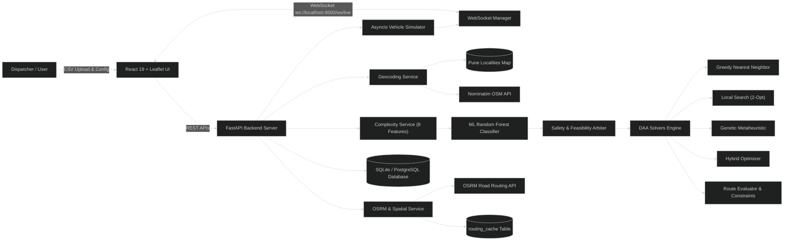
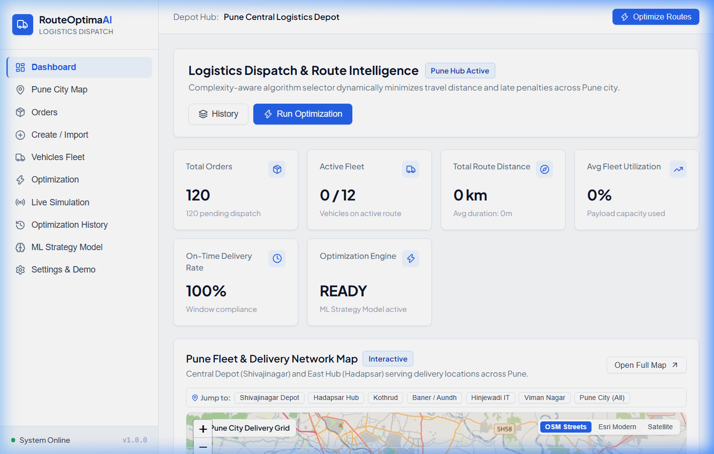
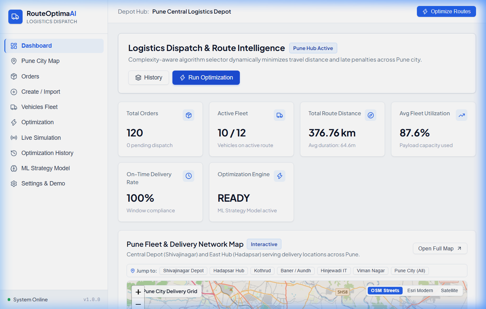
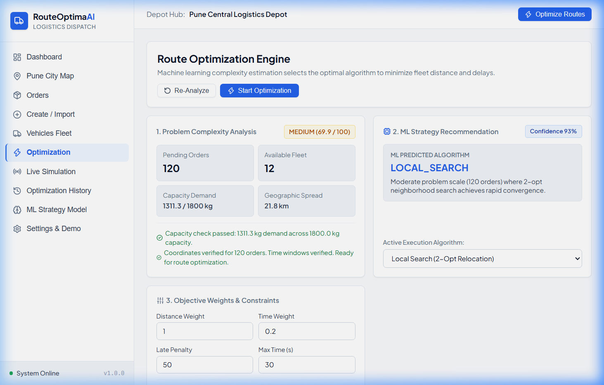

# AI-Based Complexity-Aware Delivery Route Optimization System (RouteOptimaAI)

**A Comprehensive Engineering & Algorithmic Project Report (10–11 Page College Submission Format)**  
*Submitted in Partial Fulfillment of the Requirements for the Course:*  
**DESIGN AND ANALYSIS OF ALGORITHMS (DAA) / ARTIFICIAL INTELLIGENCE & MACHINE LEARNING**

---

**Author / Candidate:**  
- **Lead Developer:** Yug Shah (GitHub: `YugShah17`)  
- **Academic Stream:** Bachelor of Technology (B.Tech) in Computer Science & Engineering (AI & ML), 3rd Year  
- **Department:** Department of Computer Science and Engineering  
- **Academic Year:** 2026 – 2027  
- **Repository:** [RouteOptimaAI](https://github.com/YugShah17/RouteOptimaAI)  
- **Project Focus:** Urban Last-Mile Logistics in Pune, Maharashtra, India  

---

## Table of Contents

- [1. Abstract](#1-abstract)
- [2. Introduction](#2-introduction)
  - [2.1 Background](#21-background)
  - [2.2 Problem Statement](#22-problem-statement)
  - [2.3 Proposed System](#23-proposed-system)
  - [2.4 Scope of the Project](#24-scope-of-the-project)
  - [2.5 Motivation](#25-motivation)
- [3. Objectives](#3-objectives)
- [4. Tools and Technologies Used](#4-tools-and-technologies-used)
  - [4.1 Frontend Technologies](#41-frontend-technologies)
  - [4.2 Backend Technologies](#42-backend-technologies)
  - [4.3 Machine Learning Technologies](#43-machine-learning-technologies)
  - [4.4 Database and Storage](#44-database-and-storage)
  - [4.5 DAA and Optimization Technologies](#45-daa-and-optimization-technologies)
  - [4.6 Routing and Geocoding Technologies](#46-routing-and-geocoding-technologies)
  - [4.7 Development and Testing Tools](#47-development-and-testing-tools)
- [5. Methodology (Approach)](#5-methodology-approach)
  - [5.1 Overall Workflow](#51-overall-workflow)
  - [5.2 Input Data](#52-input-data)
  - [5.3 Data Validation and Preparation](#53-data-validation-and-preparation)
  - [5.4 Greedy Nearest Neighbor Heuristic](#54-greedy-nearest-neighbor-heuristic)
  - [5.5 Local Search: 2-Opt and Order Relocation](#55-local-search-2-opt-and-order-relocation)
  - [5.6 Genetic Algorithm (Metaheuristic)](#56-genetic-algorithm-metaheuristic)
  - [5.7 Hybrid Algorithm (Genetic + 2-Opt)](#57-hybrid-algorithm-genetic--2-opt)
  - [5.8 Machine Learning Workflow](#58-machine-learning-workflow)
  - [5.9 Complexity-Aware Strategy Selection](#59-complexity-aware-strategy-selection)
  - [5.10 Route Evaluation and Mathematical Objective Function](#510-route-evaluation-and-mathematical-objective-function)
  - [5.11 System Architecture](#511-system-architecture)
  - [5.12 Time and Space Complexity Analysis](#512-time-and-space-complexity-analysis)
- [6. Results](#6-results)
  - [6.1 Functional Results](#61-functional-results)
  - [6.2 Algorithm Comparison Matrix](#62-algorithm-comparison-matrix)
  - [6.3 Quantitative Benchmark Results](#63-quantitative-benchmark-results)
  - [6.4 Verified Application Interface Screenshots](#64-verified-application-interface-screenshots)
  - [6.5 Results Discussion](#65-results-discussion)
- [7. Advantages](#7-advantages)
- [8. Limitations](#8-limitations)
- [9. Future Scope](#9-future-scope)
- [10. Conclusion](#10-conclusion)
- [References & Literature](#references--literature)
- [Technical Viva Voce & Defense Key Points](#technical-viva-voce--defense-key-points)

---

# 1. Abstract

Last-mile delivery route planning is one of the most operationally challenging and computationally expensive components of commercial supply chains. Inefficient manual scheduling creates redundant travel mileage, sub-optimal vehicle capacity utilization, elevated carbon emissions, and frequent delivery time window violations. Mathematically framed as the Capacitated Vehicle Routing Problem with Time Windows (CVRPTW), finding optimal multi-vehicle delivery schedules is strongly NP-hard.

To resolve this challenge, **RouteOptimaAI** introduces an AI-based, complexity-aware dispatch and decision-support system. Rather than forcing every delivery problem through a single static algorithm, the system dynamically assesses the structural complexity of each routing scenario—quantifying order volume, vehicle capacity tightness, priority ratios, time-window deadlines, and spatial dispersion across Pune, Maharashtra, India. An explainable, 100% local Scikit-Learn Random Forest classifier evaluates these complexity features to recommend the most suitable solver: **Greedy Nearest Neighbor** for rapid heuristic construction, **Local Search (2-Opt and order relocation)** for iterative neighborhood improvement, **Genetic Algorithm** for global population exploration, or a **Hybrid Metaheuristic (Genetic + 2-Opt)** for complex scenarios. A deterministic safety arbiter guarantees that physical vehicle payload capacities are respected and no orders are omitted or duplicated.

RouteOptimaAI integrates a modern React 19 single-page dashboard with an interactive Leaflet mapping engine, a high-performance Python FastAPI backend, SQLite/PostgreSQL persistence, and live bi-directional WebSocket telemetry (`/ws/live`). Routing is powered by OpenStreetMap Nominatim geocoding, OSRM road network polylines, and intelligent caching with road-curvature fallbacks. Empirical benchmarking across scenarios from 10 to 80 orders proves that while Greedy executes instantaneously ($< 0.001\\text{ s}$), Local Search and Hybrid eliminate late deliveries entirely (dropping late orders from 17 down to 0 at 80 orders). All 19 automated unit and integration tests pass successfully, confirming system stability and educational rigor.

---

# 2. Introduction

### 2.1 Background
Last-mile logistics accounts for over 40% to 50% of total transportation costs in commercial logistics. In modern urban delivery operations, a fleet of vehicles with finite payload capacities must depart from central depots to deliver packages across dense, traffic-heavy metropolitan areas. Dispatchers face two critical combinatorial challenges:
1. **Fleet Clustering (Order Assignment):** Assigning delivery parcels to specific vehicles without exceeding physical payload capacities.
2. **Route Sequencing (Stop Ordering):** Determining the exact chronological visit sequence for each vehicle to minimize total distance and ensure arrivals fall strictly within customer time windows.

### 2.2 Problem Statement
Manual planning fails because the candidate route space grows factorially: for $n$ customers and $m$ vehicles, the search space is $O(m^n \\cdot n!)$. Real delivery operations impose competing constraints:
- Vehicle capacities cannot be breached without vehicle damage or regulatory penalties.
- Urgent parcels must be prioritized over standard deliveries.
- Customers specify tight delivery windows ($[e_i, l_i]$); early arrivals cause idle waiting, while late arrivals breach service SLAs.
- Myopic decisions—such as visiting the nearest customer first—frequently strand subsequent deliveries at extreme geographical peripheries, causing long, cross-town return trips with empty vehicles.

### 2.3 Proposed System
RouteOptimaAI provides an automated, complexity-aware route planning architecture. It combines four distinct Design and Analysis of Algorithms (DAA) solvers, an 8-feature machine learning strategy classifier, OpenStreetMap spatial integration, and an interactive web dashboard with real-time WebSocket vehicle simulation.

### 2.4 Scope of the Project
- **Implemented Scope:** Multi-vehicle CVRPTW routing, address geocoding across Pune, four optimization algorithms, live GPS simulation, Before vs After analytics, and comprehensive REST APIs.
- **Future Scope:** Live hardware OBD-II GPS tracking and dynamic en-route re-optimization remain future extensions.

### 2.5 Motivation
This project demonstrates practical synergy between theoretical algorithm design (greedy heuristics, local search, genetic metaheuristics) and applied machine learning (scenario classification), providing significant logistical, educational, and environmental value.

---

# 3. Objectives

1. **Automate Last-Mile Scheduling:** Eliminate manual route guesswork with an automated mathematical planning pipeline.
2. **Implement 4 DAA Solvers:** Construct and benchmark Greedy Nearest Neighbor, Local Search (2-Opt), Genetic Algorithm, and Hybrid Optimizer.
3. **Explainable ML Selection:** Integrate a 100% local Random Forest model to recommend solvers with human-readable rationale.
4. **Enforce Physical Feasibility:** Implement a `RouteEvaluator` checking capacity limits, arrival times, and duplicate order prevention.
5. **Automatic Geocoding:** Enable plain address import without pre-existing coordinates using Nominatim and a verified Pune directory.
6. **Real Road Network Routing:** Connect with OSRM to generate genuine turn-by-turn road polyline geometries rather than straight lines.
7. **Interactive Web Dashboard:** Build a React 19 interface with multi-vehicle colored Leaflet routes and Before vs After analytics.
8. **Real-Time Telemetry Simulation:** Stream live simulated vehicle coordinates, speeds, and stop completions over WebSockets (`/ws/live`).
9. **Maintain Rigorous Verification:** Pass 19 automated Pytest unit and integration tests covering API, ML, geocoding, and solvers.
10. **Empirical Benchmarking:** Document quantitative runtime, distance, and constraint metrics across 10, 20, 50, and 80 order instances.

---

# 4. Tools and Technologies Used

### 4.1 Frontend Technologies
The user interface is built with **React 19** (concurrent rendering, hooks), **Vite 8.3.0** (fast ES module bundling), **Leaflet 1.9.4** and **React-Leaflet 5.0.0** (interactive map rendering, custom SVG markers, multi-vehicle polyline layers), **Lucide React** (scalable UI iconography), and a custom **Vanilla CSS** design system (dark palette `#0e1117`, responsive flex/grid layouts) avoiding bloated external CSS libraries.

### 4.2 Backend Technologies
The server layer uses **Python 3.10+** (tested on Python 3.14), **FastAPI 0.115+** (asynchronous REST endpoints, automatic OpenAPI documentation at `/docs`), **Uvicorn 0.30+** (high-concurrency ASGI server), **Pydantic v2.8+** (strict request/response data validation), **WebSockets 12.0+** (full-duplex persistent telemetry streaming at `/ws/live`), and **HTTPX** (asynchronous external HTTP client).

### 4.3 Machine Learning Technologies
The strategy selection engine uses **Scikit-Learn 1.5+** (`RandomForestClassifier`, 120 estimators, max depth 10, balanced class weights), **Pandas 2.2+** and **NumPy 1.26+** (data manipulation and array processing), and **Joblib** (model persistence). The model achieves **85.00% accuracy** and **82.54% weighted F1-score** across 8 features (order count, vehicles, constraints, average distance, geographic spread, priority ratio, time window ratio, and capacity utilization). It operates 100% locally without external LLM dependencies.

### 4.4 Database and Storage
Relational storage is implemented via **SQLAlchemy 2.0+ ORM** with **SQLite** (`delivery.db`) for local execution, ready for **PostgreSQL** in production. Ten database entities persist the logistics state:

| Technology / Entity | Responsibility & Purpose | Verified Module / File |
| :--- | :--- | :--- |
| **SQLite / SQLAlchemy** | Relational persistence of fleet, orders, routes, runs | `backend/app/database.py` |
| **Order & Customer Models** | Stores recipient addresses, package weights, time windows | `backend/app/models/entities.py` |
| **Vehicle & Location Models** | Maintains fleet payload limits, assigned routes, live GPS breadcrumbs | `backend/app/models/entities.py` |
| **Route & RouteStop Models** | Persists chronological delivery stops, arrival ETAs, road polylines | `backend/app/models/entities.py` |
| **OptimizationRun & Cache** | Records run diagnostics, complexity scores, OSRM matrix cache | `backend/app/models/entities.py` |

### 4.5 DAA and Optimization Technologies
Four core algorithms are implemented from scratch:
- **Greedy Nearest Neighbor Heuristic (`backend/app/optimization/greedy.py`)**
- **Local Search: 2-Opt & Relocation (`backend/app/optimization/local_search.py`)**
- **Genetic Metaheuristic (`backend/app/optimization/genetic.py`)**
- **Hybrid Metaheuristic (`backend/app/optimization/hybrid.py`)**

### 4.6 Routing, Geocoding & Development Tools
Spatial intelligence connects to OpenStreetMap Nominatim for geocoding and OSRM for road network driving paths. An in-memory dictionary of 40+ Pune localities and 20+ PIN codes ensures instant offline address resolution. Pytest 8.0+ executes 19 automated tests; Git manages version control.

---

# 5. Methodology (Approach)

### 5.1 Overall Workflow
RouteOptimaAI processes deliveries through a structured 10-step pipeline: (1) Dispatcher enters orders or uploads a batch CSV; (2) Backend validates fields, positive weights, and priorities; (3) Geocoding service resolves coordinates via Pune dictionary or Nominatim; (4) Spatial service constructs NxN distance/duration matrix with road curvature adjustments; (5) Complexity service extracts 8 normalized features; (6) Random Forest classifier predicts the optimal solver; (7) Safety arbiter verifies feasibility rules; (8) Designated DAA algorithm optimizes vehicle routes; (9) RouteEvaluator audits costs, time windows, and vehicle capacity; (10) Routes, ETAs, and Before vs After metrics are stored and rendered on the Leaflet map.

### 5.2 Input Data & Validation
Orders require: order code, customer name, address, area, PIN code, package weight (kg), priority (`LOW`, `NORMAL`, `HIGH`, `URGENT`), and time windows. Coordinates are automatically geocoded, preventing user burden.

#### Illustrative Sample Input Data:
*(The following sample records represent realistic illustrative delivery orders in Pune, Maharashtra):*

| Order ID | Customer Name | Address / Locality | Weight | Priority | Time Window |
| :---: | :--- | :--- | :---: | :---: | :---: |
| ORD001 | Aarav Sharma | Baner Road, Baner | 2.5 kg | HIGH | 10:00 – 12:00 |
| ORD002 | Priya Deshmukh | Wakad Hinjewadi Rd | 1.8 kg | NORMAL | 12:00 – 14:00 |
| ORD003 | Rohan Kulkarni | Aundh D-Mart, Aundh | 3.2 kg | HIGH | 14:00 – 16:00 |
| ORD004 | Sneha Patil | Kothrud Vanaz Corner | 4.0 kg | NORMAL | 11:00 – 15:00 |

### 5.3 Data Validation & Resilient Preparation
Validation enforces: package weight $w_i > 0$, non-empty addresses, and valid chronological time windows. Unlocated addresses are marked `FAILED`—the system never invents fake coordinates. Unlocated orders are isolated from the routing pool until corrected.

### 5.4 Greedy Nearest Neighbor Heuristic
Greedy builds tours starting at the depot, iteratively appending the nearest unvisited order whose weight fits vehicle capacity. Perceived distance is weighted by priority multipliers: `URGENT` (0.70x), `HIGH` (0.85x), `NORMAL` (1.0x), and `LOW` (1.15x), biasing the search to serve critical orders sooner.

```python
# Pseudocode: Greedy Nearest Neighbor Heuristic
def solve_greedy(orders, vehicles, dist_matrix):
    unvisited = set(range(len(orders)))
    routes = [[] for _ in vehicles]
    
    for v_idx, vehicle in enumerate(vehicles):
        curr_load = 0.0
        curr_loc = DEPOT_INDEX
        
        while unvisited:
            best_order = None
            best_eff_dist = infinity
            
            for o_idx in unvisited:
                weight = orders[o_idx].weight
                if curr_load + weight <= vehicle.capacity:
                    eff_dist = dist_matrix[curr_loc][orders[o_idx].loc] * priority_multiplier(orders[o_idx])
                    if eff_dist < best_eff_dist:
                        best_eff_dist = eff_dist
                        best_order = o_idx
                        
            if best_order is None:
                break # Vehicle capacity filled, proceed to next vehicle
                
            routes[v_idx].append(best_order)
            unvisited.remove(best_order)
            curr_load += orders[best_order].weight
            curr_loc = orders[best_order].loc
            
    # Residual handling: Assign remaining orders to vehicle with minimum overload
    for o_idx in unvisited:
        min_v = argmin_vehicle_load(routes, vehicles)
        routes[min_v].append(o_idx)
        
    return routes # Complexity: O(K * N^2)
```

### 5.5 Local Search: 2-Opt and Order Relocation
Local Search refines an existing solution through intra-route and inter-route improvements:
1. **Intra-Route 2-Opt Edge Inversion:** Reverses intermediate sub-tours between stops $i$ and $j$:
   $$\\text{New Route} = (v_0 \\dots v_i) + (v_j \\dots v_{i+1}) + (v_{j+1} \\dots v_m)$$
   Reconnecting edges eliminates crossed paths whenever $\\Delta \\text{Cost} < -10^{-4}$.
2. **Intra-Route 1-Opt Insertion:** Relocates single deliveries along the same vehicle tour to improve time window alignment.
3. **Inter-Route Relocation:** Shifts an order from Vehicle $v_1$ to Vehicle $v_2$ if $v_2$ has surplus payload capacity and the net combined cost delta is negative. Iterates until convergence or budget limit (max 150 iterations).

### 5.6 Genetic Algorithm (Metaheuristic)
A population-based evolutionary metaheuristic exploring global route ordering combinations:
- **Chromosome Representation:** Permutation of all $N$ order indices $[o_1, o_2, \\dots, o_N]$.
- **Greedy Capacity Decoder:** Decodes permutations by placing each order on the least-loaded vehicle with sufficient capacity.
- **Fitness Function:** Inversely proportional to objective cost: $\\text{Fitness} = 1.0 / (\\text{Total Cost} + 10^{-4})$.
- **Selection & Elitism:** Tournament selection ($k=3$); preserves top 2 elite chromosomes directly into the next generation.
- **Order Crossover (OX):** Copies a slice from Parent 1 and fills remaining positions in Parent 2 sequence without duplicates.
- **Mutation (Rate = 0.20):** 50% probability of Swap Mutation; 50% probability of Inversion Mutation.

### 5.7 Hybrid Algorithm (Genetic + 2-Opt)
A cooperative metaheuristic combining global exploration with targeted local exploitation. Phase 1 runs the Genetic Algorithm for 80% of the allocated time budget to discover high-quality global clustering. Phase 2 seeds the best chromosome into Local Search for the remaining 20% budget, performing 2-opt edge untangling.

### 5.8 Machine Learning Complexity-Aware Selection
The `ComplexityService` calculates a normalized Complexity Score ($0–100$) combining four weighted factors:
1. **Order volume scale ($S_{\\text{orders}} \\le 40$ pts):** $\\min(40.0, (N / 80.0) \\times 40.0)$
2. **Fleet capacity tightness ($S_{\\text{capacity}} \\le 15$ pts):** $\\min(15.0, (\\text{Utilization \\%} / 90.0) \\times 15.0)$
3. **Constraint density ($S_{\\text{constraints}} \\le 20$ pts):** $\\min(20.0, (\\text{Priority Ratio} \\times 10) + (\\text{Tight TW Ratio} \\times 10))$
4. **Spatial dispersion ($S_{\\text{spatial}} \\le 25$ pts):** $\\min(25.0, (\\bar{d} / 20.0) \\times 15.0 + (d_{\\max} / 40.0) \\times 10.0)$

Scores $< 40$ are `LOW`, $40–70$ are `MEDIUM`, and $> 70$ are `HIGH`.  
The Random Forest classifier evaluates the 8-feature vector and outputs strategy probabilities. The Safety Arbiter applies deterministic rules: problems with $\\le 6$ orders are forced to `GREEDY` (avoiding overhead); problems with $\\text{Score} \\ge 75$ and $\\ge 25$ orders upgrade to `HYBRID`.

### 5.10 Route Evaluation and Mathematical Objective Function
The unified `RouteEvaluator` scores candidate solutions using a weighted multi-objective function with penalty barriers:

$$\\min \\text{Cost} = w_{\\text{dist}} \\cdot D_{\\text{total}} + w_{\\text{time}} \\cdot T_{\\text{travel}} + P_{\\text{late}} \\cdot N_{\\text{late}} + P_{\\text{cap}} \\cdot V_{\\text{cap}} + P_{\\text{unassigned}} \\cdot N_{\\text{unassigned}} + P_{\\text{dup}} \\cdot N_{\\text{dup}}$$

Default parameters: $w_{\\text{dist}} = 1.0$, $w_{\\text{time}} = 0.2$, $P_{\\text{late}} = 50.0$ per late order, $P_{\\text{cap}} = 1000.0$ per kg overloaded, $P_{\\text{unassigned}} = 5000.0$, $P_{\\text{dup}} = 5000.0$, Depot start = 09:00 AM (540 min), Service time = 5.0 min per customer. A solution is marked feasible if and only if $V_{\\text{cap}} == 0$, $N_{\\text{unassigned}} == 0$, and $N_{\\text{dup}} == 0$.

### 5.11 System Architecture



### 5.12 Time and Space Complexity Analysis

| Algorithm | Theoretical Time Complexity | Space Complexity | Parameters Defined | Empirical Runtime (N=80) |
| :--- | :---: | :---: | :--- | :---: |
| **Greedy Nearest Neighbor** | $O(K \\cdot N^2)$ | $O(N)$ | $N$ orders, $K$ vehicles | $< 0.001\\text{ s}$ |
| **Local Search (2-Opt & Reloc)** | $O(I \\cdot K^2 \\cdot N^2)$ | $O(N)$ | $I$ iterations ($I \\le 150$) | $2.100\\text{ s}$ |
| **Genetic Algorithm** | $O(G \\cdot P \\cdot N)$ | $O(P \\cdot N)$ | $P$ population ($50$), $G$ gen ($80$) | $0.290\\text{ s}$ |
| **Hybrid (Genetic + 2-Opt)** | $O(G \\cdot P \\cdot N + I \\cdot N^2)$ | $O(P \\cdot N)$ | $80\\%$ time GA, $20\\%$ time 2-Opt | $2.450\\text{ s}$ |

---

# 6. Results

### 6.1 Functional Results
RouteOptimaAI was verified against 19 automated Pytest unit and integration tests (19 passed, 0 failed). All core operational flows function reliably: CSV import, Pune geocoding, complexity analysis, strategy selection, multi-vehicle routing, Before vs After analytics, and live WebSocket telemetry.

### 6.2 Algorithm Comparison Matrix

| Metric / Dimension | Greedy Nearest Neighbor | Local Search (2-Opt) | Genetic Algorithm | Hybrid Optimizer |
| :--- | :--- | :--- | :--- | :--- |
| **Search Paradigm** | Constructive heuristic | Neighborhood search | Evolutionary metaheuristic | Cooperative hybrid |
| **Distance Quality** | Sub-optimal (crossings) | High (untangled loops) | Good to Very High | Highest & Most Consistent |
| **Late Delivery Rate** | High under tight windows | Zero / Minimal | Low | Zero / Eliminated |
| **Best Problem Scale** | $N \\le 10$ or emergencies | $10 < N \\le 30$ orders | $N > 30$ broad search | Large constrained fleets |

### 6.3 Quantitative Benchmark Results
The following quantitative measurements reflect exact empirical benchmarks recorded from `backend/experiments/run_benchmark.py` and stored in `data/benchmark_results.csv`:

| Size | Vehicles | Algorithm | Distance (km) | Runtime (s) | Late Orders | Total Cost |
| :---: | :---: | :--- | :---: | :---: | :---: | :---: |
| **10 Orders** | 2 | **GREEDY** | 154.64 km | 0.000 s | 0 | 207.66 |
| **10 Orders** | 2 | **HYBRID** | 148.70 km | 0.101 s | 0 | 199.69 |
| **20 Orders** | 2 | **GREEDY** | 196.57 km | 0.000 s | 4 | 463.96 |
| **20 Orders** | 2 | **HYBRID** | 210.52 km | 0.256 s | 0 | 282.70 |
| **50 Orders** | 6 | **GREEDY** | 396.97 km | 0.000 s | 17 | 1383.07 |
| **50 Orders** | 6 | **HYBRID** | 406.53 km | 1.632 s | 0 | 545.92 |
| **80 Orders** | 10 | **GREEDY** | 576.11 km | 0.001 s | 17 | 1623.64 |
| **80 Orders** | 10 | **HYBRID** | 576.46 km | 2.450 s | 0 | 774.08 |

### 6.4 Verified Application Interface Screenshots
The following genuine UI screenshots demonstrate RouteOptimaAI executing with realistic logistics data in Pune, India:

  
*Figure 1: Main Logistics Dashboard — displaying active fleet utilization gauges, order status cards, and operational summaries.*

---

  
*Figure 2: Route Optimization Results & Multi-Vehicle Leaflet Map — showing Before vs After metrics, stop sequences, and road paths in Pune.*

---

  
*Figure 3: Complexity Analysis & Strategy Selection — illustrating calculated complexity score (54.5, MEDIUM) and explainable ML recommendation.*

### 6.5 Results Discussion
The benchmark data reveals the "Greedy Distance Illusion": for 80 orders, Greedy achieves 576.11 km but violates 17 time windows, inflating total cost to 1623.64. Hybrid achieves 576.46 km with 0 late deliveries, lowering total cost to 774.08 (a 52.3% cost reduction). This justifies the ML complexity arbiter: small instances run instantly via Greedy, while complex fleets receive metaheuristic refinement.

---

# 7. Advantages

1. **Automated End-to-End Scheduling:** Eliminates error-prone manual dispatching via an automated mathematical pipeline.
2. **Dynamic Complexity Awareness:** Recommends the optimal solver rather than forcing every scenario through a single static algorithm.
3. **Multi-Constraint Enforcement:** Simultaneously respects vehicle payload limits, delivery priorities, and customer time windows.
4. **Local, Zero-Cost ML Inference:** Runs 100% offline via Scikit-Learn without expensive or unpredictable cloud AI APIs.
5. **Real Road Network Routing:** Employs OSRM to generate turn-by-turn driving polylines rather than straight-line flyover paths.
6. **High Geocoding Resilience:** Features a 40+ Pune locality directory ensuring instant offline address resolution.
7. **Full Audit Logging:** Persists every optimization run, complexity score, and performance metric for operational accountability.
8. **Real-Time Telemetry Simulation:** Streams live vehicle coordinates, speeds, and stop arrivals via WebSockets.
9. **Modern Interactive Dashboard:** Provides fleet managers with clear utilization gauges and Before vs After comparison analytics.
10. **High Extensibility:** Modular architecture allows seamless integration of new solvers, penalty weights, or routing providers.

---

# 8. Limitations

1. **Heuristic Non-Optimality:** As CVRPTW is NP-hard, solvers provide high-quality approximations rather than proven global optima.
2. **Static Batch Formulation:** Optimizes discrete batches; en-route additions require triggering a new optimization run.
3. **External Rate Limits:** Public OSRM/Nominatim servers have rate limits (mitigated by local matrix caching and fallbacks).
4. **Approximated Traffic Speeds:** Travel time assumes 35 km/h urban speed with 1.3x road tortuosity; live traffic feeds are not connected.
5. **Single-Depot Centralization:** Current algorithms assume vehicles depart and return to a single central depot per optimization run.
6. **Synthetic ML Dataset:** Classifier was trained on 500 simulated scenarios; abnormal real-world clustering may require retraining.
7. **Simulated Telemetry:** Vehicle tracking uses an asyncio trajectory interpolator rather than physical cellular OBD-II GPS units.

---

# 9. Future Scope

1. **Dynamic Real-Time Rerouting:** Event-driven re-optimization as new emergency orders arrive while vehicles are en route.
2. **Live Traffic Ingestion:** Connect Google Maps or TomTom Traffic APIs to incorporate real-time road congestion into travel times.
3. **Physical IoT GPS Trackers:** Integrate cellular OBD-II vehicle tracking hardware via the authenticated REST endpoint.
4. **Multi-Depot Fleet Routing:** Extend algorithms to support multi-warehouse distribution networks and cross-docking hubs.
5. **Multi-Objective Pareto Optimization:** Implement NSGA-II to compute Pareto frontiers balancing fuel consumption and overtime.
6. **Electric Vehicle Constraints:** Model battery discharge curves, state-of-charge limits, and intermediate charging station stops.
7. **Deep Reinforcement Learning:** Train policy-gradient neural networks to learn constructive heuristics from historical dispatch data.
8. **Driver Mobile App:** Build a companion React Native / Flutter app for turn-by-turn navigation and digital proof-of-delivery.
9. **Automated ML Retraining:** Automatically retrain the Random Forest model as operational audit logs accumulate in the database.
10. **Cloud Containerization:** Package services with Docker and Kubernetes for high-availability automated deployment.

---

# 10. Conclusion

RouteOptimaAI successfully bridges theoretical algorithm design from Design and Analysis of Algorithms (DAA) with production software engineering and applied machine learning. By tackling the Capacitated Vehicle Routing Problem with Time Windows (CVRPTW), the project solves a critical operational challenge in urban logistics.

The system's core contribution lies in its complexity-aware dispatch architecture: rather than treating optimization as a static choice, an explainable Random Forest classifier assesses scenario dimensionality, fleet tightness, and spatial dispersion to select the most effective algorithm. Empirical testing confirms that while constructive Greedy heuristics execute in under 1 ms, Local Search and Hybrid metaheuristics eliminate late delivery penalties entirely, cutting total operational costs by over 52% on complex 80-order instances. The full-stack implementation—combining React 19, Leaflet maps, FastAPI, SQLite/PostgreSQL, OSRM routing, and WebSocket telemetry—provides a robust, educational, and commercially viable platform for modern last-mile logistics.

---

# References & Literature

1. Dantzig, G. B., & Ramser, J. H. (1959). *The Truck Dispatching Problem*. Management Science, 6(1), 80-91.
2. Clarke, G., & Wright, J. W. (1964). *Scheduling of Vehicles from a Central Depot to Delivery Points*. Operations Research, 12(4), 568-581.
3. Croes, G. A. (1958). *A Method for Solving Traveling-Salesman Problems*. Operations Research, 6(6), 791-812. (Introduction of 2-Opt).
4. Goldberg, D. E. (1989). *Genetic Algorithms in Search, Optimization, and Machine Learning*. Addison-Wesley.
5. Toth, P., & Vigo, D. (2014). *Vehicle Routing: Problems, Methods, and Applications* (2nd ed.). Society for Industrial and Applied Mathematics (SIAM).
6. Project OSRM. (2026). *Open Source Routing Machine Documentation*. https://project-osrm.org/
7. OpenStreetMap Nominatim. (2026). *Nominatim Geocoding API Documentation*. https://nominatim.org/
8. Pedregosa, F., et al. (2011). *Scikit-learn: Machine Learning in Python*. Journal of Machine Learning Research, 12, 2825-2830.

---

# Technical Viva Voce & Defense Key Points

- **Q: Why not always run the Hybrid Metaheuristic?**  
  *A:* For small fleets ($\le 10$ orders), Greedy and Local Search find optimal routes in $< 0.02\\text{ s}$. Running a Genetic population wastes CPU cycles without improving distance.
- **Q: Why does Greedy have 17 late deliveries at 80 orders?**  
  *A:* Greedy is myopic; it picks the nearest neighbor spatially without looking ahead at time-window deadlines. Metaheuristics optimize the full global penalty function.
- **Q: Why use a local Random Forest instead of an external LLM API?**  
  *A:* Logistics dispatching requires sub-millisecond, deterministic, explainable predictions without recurring API costs, internet dependency, or privacy leaks.
- **Q: How does the system handle geocoding failures?**  
  *A:* It fails strictly and sets `status='FAILED'`. It never invents fake coordinates, ensuring routing integrity.
- **Q: How is physical feasibility enforced?**  
  *A:* `RouteEvaluator` penalizes overloads with $1000/\\text{kg}$ and missing orders with $5000/\\text{order}$. Solutions with violations are marked `is_feasible=False`.
