# RouteOptimaAI — System Architecture Diagram

> **Visual System Architecture Document**  
> *Inspired by enterprise technical blueprint aesthetics: dark background, left-to-right flow, modular service rectangles, database cylinders, and labeled data-flow connectors.*

---

## 1. Interactive Architecture Diagram (Mermaid)

The diagram below maps the complete end-to-end data flow of **RouteOptimaAI**, from dispatcher interaction and frontend state management through the FastAPI gateway, hybrid geocoding pipeline, ML complexity classifier, DAA optimization solvers, road routing engine, live telemetry simulation, and persistent storage.

```mermaid
%%{init: {
  'theme': 'dark',
  'themeVariables': {
    'darkMode': true,
    'background': '#0e1117',
    'primaryColor': '#1e222b',
    'primaryTextColor': '#ffffff',
    'primaryBorderColor': '#4a5568',
    'lineColor': '#718096',
    'secondaryColor': '#161920',
    'tertiaryColor': '#2d3748',
    'fontFamily': 'Inter, system-ui, sans-serif'
  }
}}%%

flowchart LR
    %% User & Presentation
    User["User: orders CSV or config"] -->|upload & configure| Frontend["React + Vite frontend"]
    Frontend -->|history & filters| BrowserStorage[("Browser localStorage")]
    Frontend -->|POST /api/orders/import| Backend["FastAPI backend"]
    Frontend -->|POST /api/optimization/run| Backend
    Frontend -->|POST /api/simulation/start| Backend
    Backend -->|WebSocket /ws/live| Frontend
    Backend -->|structured JSON result| Frontend

    %% Backend Subsystems Branching
    Backend -->|geocode address| GeocodeRouter["Geocoding router"]
    Backend -->|extract 8 features| ComplexityBuilder["Complexity feature builder"]
    Backend -->|select & execute| DAAEngine["DAA optimization engine"]
    Backend -->|driving road geometry| RoutingService["Routing & distance service"]
    Backend -->|background loop| SimEngine["Asyncio simulation engine"]
    Backend -->|SQLAlchemy ORM| DBStorage[("SQLite database delivery.db")]

    %% Geocoding Branch
    GeocodeRouter -->|local match| PuneDict[("Local Pune dictionary - 40+ areas")]
    GeocodeRouter -->|PIN match| PunePIN[("Pune PIN code map - 25+ PINs")]
    GeocodeRouter -->|remote query| NominatimAPI["Nominatim OSM API"]
    GeocodeRouter -->|unresolved| StrictFail["Strict validation - status FAILED"]

    %% Complexity & ML Strategy Classifier Branch
    ComplexityBuilder -->|normalized vector| MLClassifier["ML strategy classifier"]
    MLClassifier -->|model configured| RFModel[("Random Forest - model.joblib 85%")]
    MLClassifier -->|fallback mode| RuleHeuristics["Deterministic heuristics"]
    MLClassifier -->|predicted strategy| StratArbiter["Safety & feasibility arbiter"]

    %% Strategy Arbiter Dispatches to DAA Solvers
    StratArbiter -->|selected strategy| DAAEngine

    %% DAA Optimization Solvers
    DAAEngine -->|orders <= 6 or low complexity| GreedySolver["Greedy nearest neighbor"]
    DAAEngine -->|moderate complexity / 2-opt| LocalSearchSolver["Local search - 2-Opt & relocation"]
    DAAEngine -->|high complexity / genetic| GeneticSolver["Genetic algorithm - Order Crossover"]
    DAAEngine -->|score >= 75 & orders >= 25| HybridSolver["Hybrid optimizer - GA + 2-Opt"]

    %% Solver Solutions to Route Evaluator
    GreedySolver -->|candidate solution| RouteEvaluator["Route evaluator & constraint checks"]
    LocalSearchSolver -->|candidate solution| RouteEvaluator
    GeneticSolver -->|candidate solution| RouteEvaluator
    HybridSolver -->|candidate solution| RouteEvaluator

    %% Constraint Checks
    RouteEvaluator -->|validate capacity| CapCheck["Vehicle capacity limit check"]
    RouteEvaluator -->|validate arrival vs end| TWCheck["Time window & lateness check"]
    RouteEvaluator -->|order coverage| CoverageCheck["Zero unassigned & duplicate check"]

    %% Routing & OSRM Branch
    RoutingService -->|sub-millisecond matrix| MatrixBuilder["Haversine 1.3x matrix builder"]
    RoutingService -->|turn-by-turn road polyline| OSRMClient["OSRM routing engine"]
    OSRMClient -->|HTTP GET /route/v1/driving| OSRMAPI["External OSRM public API"]
    RoutingService -->|cached road segments| RoutingCache[("routing_cache table")]

    %% Simulation Engine Branch
    SimEngine -->|segment interpolation| TelemetryGen["Live GPS telemetry generator"]
    TelemetryGen -->|broadcast position| WSManager["WebSocket connection manager"]
    WSManager -->|live vehicle coords| Frontend
    TelemetryGen -->|persist location audit| LocHistory[("vehicle_locations table")]

    %% Database Entities
    DBStorage --- OrdersTable[("orders table")]
    DBStorage --- VehiclesTable[("vehicles table")]
    DBStorage --- RoutesTable[("routes & route_stops")]
    DBStorage --- RunsTable[("optimization_runs & metrics")]
    DBStorage --- ModelsTable[("model_versions table")]

    %% Node Styling matching reference aesthetic
    classDef default fill:#161920,stroke:#4a5568,stroke-width:1.2px,color:#ffffff;
    classDef cylinderNode fill:#1c212d,stroke:#5a67d8,stroke-width:1.5px,color:#e2e8f0;
    classDef highlightNode fill:#1a2332,stroke:#3182ce,stroke-width:1.5px,color:#ffffff;
    classDef warningNode fill:#2d1519,stroke:#e53e3e,stroke-width:1.2px,color:#feb2b2;

    class BrowserStorage,PuneDict,PunePIN,RFModel,RoutingCache,LocHistory,DBStorage,OrdersTable,VehiclesTable,RoutesTable,RunsTable,ModelsTable cylinderNode;
    class Frontend,Backend,DAAEngine,MLClassifier,RoutingService,SimEngine highlightNode;
    class StrictFail warningNode;
```

---

## 2. Visual Architecture Image

The rendered architecture picture reflecting this exact technical blueprint layout:

*High-Resolution Image Assets:*
- **High-Definition PNG**: [`docs/architecture.png`](architecture.png)
- **High-Definition JPEG**: [`docs/architecture.jpg`](architecture.jpg)
- **Scalable Vector Graphic (SVG)**: [`docs/architecture.svg`](architecture.svg)
- **Standalone Mermaid File**: [`docs/architecture.mmd`](architecture.mmd)

---

## 3. Structural Mapping to Reference Architecture Style

This diagram directly implements the design patterns from the reference blueprint:

| Reference Architecture Pattern | How it is Implemented in RouteOptimaAI |
|---|---|
| **Dark Blueprint Aesthetic** | Near-black canvas (`#0e1117`), dark slate nodes (`#161920`), thin grey borders (`#4a5568`), high-contrast white typography. |
| **Left-to-Right Progression** | `User Input` $\to$ `React Frontend` $\to$ `FastAPI Backend` $\to$ `Modular Subsystems` $\to$ `Solvers & Evaluator` $\to$ `Storage & External APIs`. |
| **Rectangular Component Blocks** | Used for all functional components, services, and algorithm implementations (`FastAPI backend`, `Intent interpreter` $\to$ `Complexity feature builder`, `Validated tool router` $\to$ `DAA optimization engine`, etc.). |
| **Cylinder Database Symbols** | Used for persistent data entities: `Browser localStorage`, `Local Pune dictionary`, `model.joblib`, `routing_cache`, and SQLite relational tables (`orders`, `vehicles`, `routes`, `optimization_runs`). |
| **Labeled Connection Connectors** | Connection lines carry concise pill labels explaining protocol and data payload: `upload & configure`, `history & filters`, `POST /api/orders/import`, `POST /api/optimization/run`, `geocode address`, `extract 8 features`, `selected strategy`, `candidate solution`, `WebSocket /ws/live`. |
| **Loop-Back Data Streams** | Bidirectional loops where `WebSocket /ws/live` and `structured JSON result` return from the backend to the frontend to update live map markers and KPI dashboards. |
| **Adapter Pattern for External Services** | Clear boundary isolating external HTTP APIs (`Nominatim OSM API`, `External OSRM public API`) with internal offline fallback adapters (`Pune locality dictionary`, `Haversine 1.3x matrix builder`). |

---

## 4. Component-by-Component Reference

### A. Presentation & Client Layer (Left)
- **`User: orders CSV or config`**: The logistics planner or operations dispatcher uploading delivery orders or configuring fleet capacity.
- **`React + Vite frontend`**: The client web application (`frontend/src/`) rendering the dashboard, interactive Leaflet delivery map, and optimization controls.
- **`Browser localStorage` [(Cylinder)]**: Stores local client preferences, active UI filters, and session tokens without server roundtrips.

### B. Backend Application Gateway (Center-Left)
- **`FastAPI backend`**: The high-performance asynchronous API server (`backend/app/main.py` & `routes_api.py`) orchestrating validation, algorithm execution, and database transactions.
- **`WebSocket /ws/live`**: Bi-directional event stream pushing real-time GPS telemetry from backend simulation to frontend map markers.

### C. Address Resolution & Geocoding Pipeline
- **`Geocoding router`**: Coordinates address-to-coordinate translation (`backend/app/services/geocoding.py`).
- **`Local Pune dictionary` [(Cylinder)]**: Sub-millisecond internal database of 40+ verified Pune localities (Baner, Kothrud, Hinjewadi, Wakad, etc.).
- **`Pune PIN code map` [(Cylinder)]**: 25+ verified postal PIN code coordinate mappings (`411001` to `412207`).
- **`Nominatim OSM API`**: Remote OpenStreetMap forward geocoding query fallback.
- **`Strict validation - status FAILED`**: Rejects unlocated addresses; never invents fake coordinates.

### D. Complexity Feature Extractor & ML Strategy Classifier
- **`Complexity feature builder`**: Extracts 8 operational features (`number_of_orders`, `number_of_constraints`, `geographical_spread`, `capacity_utilization`, etc.) in `backend/app/services/complexity.py`.
- **`ML strategy classifier`**: Evaluates problem difficulty to recommend an optimization strategy.
- **`Random Forest - model.joblib 85%` [(Cylinder)]**: Pre-trained scikit-learn model (`backend/ml/model.joblib`) with 85.0% accuracy.
- **`Deterministic heuristics`**: Rule-based fallback if model is uninitialized.
- **`Safety & feasibility arbiter`**: Enforces physical boundaries (e.g. orders $\le 6 \implies$ Greedy; score $\ge 75 \implies$ Hybrid).

### E. DAA Optimization Suite (Center-Right)
- **`DAA optimization engine`**: Dynamic solver multiplexer in `backend/app/optimization/`.
- **`Greedy nearest neighbor`**: $O(N^2)$ heuristic with priority multipliers (`URGENT: 0.7x`, `HIGH: 0.85x`, `NORMAL: 1.0x`, `LOW: 1.15x`).
- **`Local search - 2-Opt & relocation`**: Iteratively uncrosses routes and relocates orders across vehicles.
- **`Genetic algorithm - Order Crossover`**: Population-based evolutionary search with Order Crossover (OX) and elitism.
- **`Hybrid optimizer - GA + 2-Opt`**: Memetic metaheuristic combining GA global exploration (80% time) with 2-Opt local refinement (20% time).

### F. Route Evaluator & Constraint Enforcement
- **`Route evaluator & constraint checks`**: Evaluates candidate solutions against weighted objective cost in `backend/app/optimization/evaluator.py`.
- **`Vehicle capacity limit check`**: Enforces that total package weight does not exceed vehicle max capacity ($1000\times$ penalty).
- **`Time window & lateness check`**: Validates customer delivery windows, service times, and lateness penalties ($50\times$).
- **`Zero unassigned & duplicate check`**: Guarantees every order is served exactly once ($5000\times$ penalty).

### G. Routing, Distance & External Services
- **`Routing & distance service`**: Spatial routing manager in `backend/app/services/routing.py`.
- **`Haversine 1.3x matrix builder`**: Instantaneous $N \times N$ distance and travel time matrix generation using road-adjusted geodesic distance.
- **`OSRM routing engine`**: Turn-by-turn driving road geometry adapter.
- **`External OSRM public API`**: Remote OSRM service (`router.project-osrm.org`) for street polylines.
- **`routing_cache table` [(Cylinder)]**: Caches road distances and GeoJSON polylines to eliminate redundant remote calls.

### H. Live Fleet Simulation Engine
- **`Asyncio simulation engine`**: Background task (`backend/app/services/simulation.py`) traversing active route polylines.
- **`Live GPS telemetry generator`**: Computes real-time vehicle coordinates, speeds, and delivery completion states.
- **`WebSocket connection manager`**: Broadcasts telemetry frames to connected frontend clients (`backend/app/services/websocket_manager.py`).
- **`vehicle_locations table` [(Cylinder)]**: Audit log of historical GPS coordinates and speeds.

### I. Persistent Storage Layer (Right)
- **`SQLite database delivery.db` [(Cylinder)]**: Relational database mapped via SQLAlchemy 2.0 ORM.
  - `orders table`: Customer delivery requirements, weights, time windows, and geocoding states.
  - `vehicles table`: Fleet registry, max capacities, current loads, and statuses.
  - `routes & route_stops`: Computed vehicle routes, stop sequences, arrival ETAs, and road polylines.
  - `optimization_runs & metrics`: Historical run audit logs, complexity scores, distances before/after, and % improvements.
  - `model_versions table`: Model accuracy, precision, recall, and feature importance logs.
