# System Architecture — RouteOptimaAI

> **AI-Based Complexity-Aware Delivery Route Optimization System**  
> *Production-Style Logistics Decision-Support and Multi-Vehicle Route Optimization Engine*

---

## 1. Executive Summary & Project Overview

**RouteOptimaAI** is an intelligent logistics planning and route optimization system designed for capacity-constrained, time-windowed last-mile parcel distribution (CVRPTW). The system resolves the classic tension between **solution quality** and **computational latency** by coupling an **offline-trained Machine Learning Strategy Classifier** with a **Design and Analysis of Algorithms (DAA) optimization engine**.

Instead of naively running slow metaheuristics on trivial delivery scenarios or applying simplistic greedy heuristics to heavily constrained urban networks, RouteOptimaAI dynamically extracts **8 multidimensional problem features**, evaluates a **Random Forest Classifier (85.0% accuracy)** to recommend an optimal algorithmic strategy, enforces **deterministic safety and feasibility rules**, and executes the selected solver across the fleet.

The system is constructed as a high-performance **modular monolith** with:
- A responsive, dark-mode **React 19 Single Page Application (SPA)** with interactive **Leaflet** road mapping and multi-vehicle routing controls.
- A **FastAPI** asynchronous REST backend with bidirectional **WebSocket (`/ws/live`)** telemetry streams.
- A hybrid **Geocoding & Matrix Preparation pipeline** combining internal verified locality databases, Nominatim forward geocoding, and road-curvature matrix builders.
- A **DAA Optimization Suite** comprising **Greedy Nearest Neighbor**, **2-Opt / Relocation Local Search**, **Order Crossover Genetic Algorithm**, and a **Memetic Hybrid Optimizer**.
- An **Asyncio Simulation Engine** emulating live vehicle GPS movements along realistic road network polylines.
- A **SQLAlchemy ORM** persistence layer supporting development SQLite and production PostgreSQL.

---

## 2. System Architecture Diagram

The system architecture is structured into **8 logical layers** with unidirectional control flows, feedback evaluation loops, and asynchronous telemetry streaming.

### Visual Architecture Diagram


> **File References:**
> - High-Resolution Image: [`docs/architecture.png`](architecture.png) / [`docs/architecture.jpg`](architecture.jpg)
> - Scalable Vector Source: [`docs/architecture.svg`](architecture.svg)
> - Editable Mermaid Diagram: [`docs/architecture.mmd`](architecture.mmd)

### System Architecture Flowchart (Mermaid Specification)

The diagram below can also be viewed and edited in [`docs/architecture.mmd`](architecture.mmd):

```mermaid
%%{init: {
  'theme': 'dark',
  'themeVariables': {
    'darkMode': true,
    'background': '#0b0f19',
    'primaryColor': '#1e293b',
    'primaryTextColor': '#f8fafc',
    'primaryBorderColor': '#3b82f6',
    'lineColor': '#60a5fa',
    'secondaryColor': '#0f172a',
    'tertiaryColor': '#1e1b4b',
    'fontFamily': 'Inter, system-ui, sans-serif'
  }
}}%%

flowchart LR
    %% PRESENTATION LAYER
    subgraph PresentationLayer["1. Presentation Layer (React 19 + Vite)"]
        direction TB
        User(["👤 Logistics Dispatcher"])
        
        subgraph FrontendPages["Frontend UI Pages"]
            DashboardUI["DashboardPage<br/>(Fleet KPIs & Metrics)"]
            OrdersUI["OrdersPage / CreateOrder<br/>(Order & CSV Management)"]
            OptUI["OptimizationPage<br/>(Strategy Controls & KPIs)"]
            LiveUI["LiveTrackingPage<br/>(Simulation Controller)"]
            MLUI["MLModelPage<br/>(Confusion Matrix & Weights)"]
        end

        subgraph MapComponents["Spatial Rendering"]
            LeafletMap["DeliveryMap (Leaflet 1.9.4)<br/>- Polyline Routes & Stop Popups<br/>- OSM / Esri / Satellite Layers"]
        end

        ApiClient["API & WebSocket Client (api.js)<br/>- REST Fetch API<br/>- WebSocket Client: /ws/live"]
    end

    %% BACKEND LAYER
    subgraph BackendLayer["2. Backend Application Layer (FastAPI)"]
        direction TB
        APIGateway["FastAPI Gateway (main.py)<br/>- CORS Middleware<br/>- API Key Security Check"]
        
        subgraph Endpoints["REST API Controllers (routes_api.py)"]
            OrderEndpoints["/api/orders & /api/orders/import<br/>(CRUD & Bulk CSV)"]
            VehicleEndpoints["/api/vehicles & /location<br/>(Fleet & Telemetry)"]
            OptEndpoints["/api/optimization/analyze & /run<br/>(Analysis & Route Trigger)"]
            SimEndpoints["/api/simulation/start & /stop<br/>(Simulation Controls)"]
            MLEndpoints["/api/ml/metrics & /model-info<br/>(Model Audit API)"]
        end

        WSManager["WebSocket Connection Manager<br/>(websocket_manager.py)<br/>- /ws/live Broadcast Stream"]
    end

    %% DATA PREPARATION LAYER
    subgraph DataPrepLayer["3. Data Prep & Geocoding Layer"]
        direction TB
        CSVParser["CSV Parser & Sanitizer<br/>(routes_api.py: import_orders_csv)"]
        
        subgraph GeocodeEngine["Geocoding Pipeline (geocoding.py)"]
            LocalDict["Local Pune Dictionary<br/>(40+ Areas & 25+ PIN codes)"]
            NominatimClient["Nominatim Geocode Client<br/>(nominatim.openstreetmap.org)"]
            StrictValidator["Coordinate Validator<br/>(Strict Failure / Zero Fake Coords)"]
        end

        MatrixBuilder["Distance Matrix Builder (routing.py)<br/>- NxN Road-Adjusted Haversine (1.3x)<br/>- Sub-millisecond Matrix Prep"]
    end

    %% ML LAYER
    subgraph MLLayer["4. Machine Learning Decision Layer"]
        direction TB
        ComplexityExtractor["Complexity Feature Extractor (complexity.py)<br/>- 8 Scenario Features Extracted<br/>- Complexity Score (0-100) & Level"]
        
        RFClassifier["Random Forest Strategy Classifier<br/>(ml_service.py / model.joblib)<br/>- Accuracy: 85.0% | 100 Estimators<br/>- Predicts: GREEDY / LOCAL_SEARCH / GENETIC"]
        
        SafetyRules["Safety & Feasibility Arbiter<br/>- Size <= 6: Force GREEDY<br/>- Score >= 75 & Size >= 25: Force HYBRID<br/>- Deterministic Fallback if Model Missing"]
    end

    %% OPTIMIZATION ENGINE LAYER
    subgraph OptEngineLayer["5. DAA Optimization Engine (backend/app/optimization/)"]
        direction TB
        
        subgraph Solvers["Optimization Algorithms"]
            GreedySolver["Greedy Nearest Neighbor (greedy.py)<br/>- Priority Multiplier (Urgent: 0.7x)<br/>- Fast Multi-Vehicle Construction"]
            LocalSearchSolver["Local Search Optimizer (local_search.py)<br/>- Intra-Route 2-Opt Inversions<br/>- Inter-Route Order Relocation"]
            GeneticSolver["Genetic Algorithm (genetic.py)<br/>- Order Crossover (OX) & Inversion<br/>- Tournament Selection & Elitism (top 2)"]
            HybridSolver["Hybrid Optimizer (hybrid.py)<br/>- Phase 1: GA Global Exploration (80% time)<br/>- Phase 2: 2-Opt Local Refinement (20% time)"]
        end

        RouteEvaluatorEngine["Route Evaluator & Validator (evaluator.py)<br/>- Objective Cost Function (Dist + Time + Penalties)<br/>- Time Window Arrival & Waiting Times<br/>- Vehicle Capacity Limit Verification<br/>- Zero Unassigned & Zero Duplicate Checks"]
    end

    %% EXTERNAL SERVICES
    subgraph ExternalServices["6. Routing & External Services"]
        direction TB
        OSRMService["OSRM Routing Engine (router.project-osrm.org)<br/>- Real Turn-by-Turn Road Polylines<br/>- Driving Speed & Travel Time"]
        OSMNominatimService["OpenStreetMap Nominatim (nominatim.openstreetmap.org)<br/>- Remote Forward Geocoding Fallback"]
    end

    %% SIMULATION ENGINE LAYER
    subgraph SimulationLayer["7. Simulation & Telemetry Engine (simulation.py)"]
        direction TB
        SimLoop["Asyncio Simulation Event Loop<br/>- Segment-by-segment Vehicle Traversal<br/>- Speed Multiplier (0.2x - 10.0x)"]
        GPSGen["GPS Telemetry & ETA Engine<br/>- Vehicle Coordinates & Speed<br/>- Stop Completion & Order Updates"]
    end

    %% PERSISTENCE LAYER
    subgraph PersistenceLayer["8. Persistence Layer (SQLAlchemy ORM)"]
        direction TB
        DB_Orders[("orders<br/>(Customer, Address, Time Window, Status)")]
        DB_Vehicles[("vehicles<br/>(Capacity, Load, GPS Coords, Status)")]
        DB_Routes[("routes & route_stops<br/>(Stop Sequence, ETA, Polylines)")]
        DB_OptRuns[("optimization_runs & metrics<br/>(Score, Strategy, Dist Saved, % Improvement)")]
        DB_Cache[("routing_cache<br/>(Origin, Destination, Polyline GeoJSON)")]
        DB_Warehouses[("warehouses<br/>(Depot Coordinates)")]
        DB_Model[("model_versions<br/>(Accuracy, F1, Feature Importances)")]
    end

    %% INTER-COMPONENT FLOWS
    User --> FrontendPages
    FrontendPages --> MapComponents
    FrontendPages --> ApiClient

    ApiClient -->|"HTTP REST Requests"| APIGateway
    ApiClient <-->|"WebSocket Stream (/ws/live)"| WSManager

    APIGateway --> Endpoints
    Endpoints --> OrderEndpoints & VehicleEndpoints & OptEndpoints & SimEndpoints & MLEndpoints

    OrderEndpoints -->|"Raw CSV Stream"| CSVParser
    CSVParser -->|"Addresses"| GeocodeEngine
    GeocodeEngine --> LocalDict
    GeocodeEngine --> NominatimClient
    NominatimClient <--> OSMNominatimService
    GeocodeEngine --> StrictValidator

    StrictValidator -->|"Validated Orders"| DB_Orders
    VehicleEndpoints --> DB_Vehicles
    OrderEndpoints --> DB_Orders

    OptEndpoints -->|"1. Read Scenario"| PersistenceLayer
    OptEndpoints -->|"2. Extract Features"| ComplexityExtractor
    ComplexityExtractor -->|"3. 8 Features"| RFClassifier
    RFClassifier -->|"4. Strategy Probabilities"| SafetyRules
    SafetyRules -->|"5. Final Strategy"| OptEndpoints

    OptEndpoints -->|"6. Build Matrices"| MatrixBuilder
    MatrixBuilder --> DB_Cache
    MatrixBuilder -.-> OSRMService

    OptEndpoints -->|"7. Execute Solver"| Solvers
    Solvers <-->|"Solution Evaluation"| RouteEvaluatorEngine
    Solvers -->|"Optimal Sequences"| OptEndpoints
    OptEndpoints -->|"Road Driving Polyline"| OSRMService
    OptEndpoints -->|"Persist Routes & Metrics"| DB_Routes
    OptEndpoints -->|"Persist Optimization Run"| DB_OptRuns
    OptEndpoints -->|"Update Cache"| DB_Cache
    OptEndpoints -->|"JSON Response"| ApiClient

    SimEndpoints -->|"Start/Stop Signal"| SimLoop
    SimLoop -->|"Read Approved Routes"| DB_Routes
    SimLoop -->|"Interpolate Position"| GPSGen
    GPSGen -->|"Update Fleet Status"| DB_Vehicles
    GPSGen -->|"Broadcast Events"| WSManager
    WSManager -->|"Live GPS Telemetry"| ApiClient
    ApiClient -->|"Update Vehicle Markers"| LeafletMap
```



---

## 3. Explanation of Each Architecture Layer

### Layer 1: Presentation Layer (Frontend UI)
- **Framework & Tooling**: Built with **React 19.2.8** and bundled with **Vite 8.3**.
- **Styling**: Tailored dark-mode CSS (`index.css` and component modules) adhering to modern dashboard ergonomics.
- **Pages**:
  - `DashboardPage.jsx`: Displays top-level KPIs (Total Orders, Fleet Utilization, On-Time Delivery Rate, Status Breakdowns, Recent Optimization Runs).
  - `OrdersPage.jsx` & `CreateOrderPage.jsx`: Full order management suite with manual single-order creation, CSV template download, bulk CSV upload, and geocoding status inspection.
  - `VehiclesPage.jsx`: Real-time fleet roster displaying max capacity, current load, utilization bars, and status.
  - `OptimizationPage.jsx`: Interactive optimization command center. Displays pending orders, active vehicles, complexity score, ML strategy recommendation badge, manual algorithm override selector, and constraint penalty sliders. Visualizes before-vs-after savings and multi-vehicle route tables.
  - `LiveTrackingPage.jsx`: Real-time fleet simulation monitoring view. Features interactive playback speed controls (1x to 10x), vehicle selection, and instant delivery stop updates.
  - `MLModelPage.jsx`: Model explainability dashboard showing model version, confusion matrix, precision, recall, F1-score, and horizontal bar charts of feature importance.
  - `PuneMapPage.jsx`: Dedicated geographic view showing the Central Depot in Pune, pending delivery locations, and cluster heatmaps.
  - `DeliveryMap.jsx`: High-performance mapping component based on **Leaflet 1.9.4** and **React-Leaflet 5.0**. Renders multi-vehicle routes using distinctive color palettes, interactive depot/order markers, turn-by-turn polylines, and switchable base maps (**OpenStreetMap Streets**, **Esri Modern**, and **Esri World Satellite**).
- **Communication Layer (`api.js`)**: Encapsulates REST fetch calls and establishes a resilient WebSocket connection with automatic exponential reconnection.

### Layer 2: Backend Application Layer (FastAPI Gateway)
- **Framework**: **FastAPI 0.110+** running on an asynchronous **Uvicorn** ASGI worker (`backend/app/main.py`).
- **Middleware & Security**:
  - `CORSMiddleware`: Protects cross-origin requests with configurable origin whitelists via `CORS_ORIGINS`.
  - `verify_simulation_api_key`: Dependency guarding vehicle telemetry endpoints (`/api/vehicles/{id}/location`) requiring an `X-API-Key` header or `?api_key=` parameter matching `SIMULATION_API_KEY`.
- **API Controllers (`backend/app/api/routes_api.py`)**:
  - Provides RESTful routes for orders, vehicles, optimization execution, simulation controls, and ML metadata.
  - Validates all payloads using Pydantic V2 schemas (`OrderCreate`, `OptimizationRunRequest`, `OptimizationAnalyzeResponse`, etc.).
- **WebSocket Connection Manager (`backend/app/services/websocket_manager.py`)**:
  - Tracks all active WebSocket connections to `/ws/live`.
  - Broadcasts non-blocking JSON frames to all connected frontend clients whenever vehicle telemetry, simulation status, or optimization progress changes.

### Layer 3: Data Preparation & Geocoding Layer
- **CSV Parser & Sanitizer**:
  - Reads raw multipart CSV uploads in memory via Python's standard `csv.DictReader`.
  - Maps headers flexibly (`customer_name`, `address`, `area`, `pincode`, `package_weight`, `priority`, `time_window_start`, `time_window_end`).
  - Sets safe defaults for missing values (e.g., default package weight = 5.0 kg, default delivery window = 09:00 to 18:00).
- **Geocoding Pipeline (`backend/app/services/geocoding.py`)**:
  - **Tier 1 (Sub-millisecond Ground Truth)**: Consults an internal dictionary of **40+ Pune localities** (Baner, Wakad, Aundh, Kothrud, Hadapsar, Hinjewadi, Viman Nagar, etc.) and **25+ Indian Postal PIN codes** (`411001` to `412207`).
  - **Tier 2 (Remote Geocoding)**: If an address is not in the locality dictionary, queries the public **OpenStreetMap Nominatim API** (`nominatim.openstreetmap.org/search`) with a 4.0-second timeout and structured query components (`address, area, pincode, Pune, Maharashtra, India`).
  - **Tier 3 (Strict Validation Policy)**: If an address cannot be resolved by either tier, the system **never invents fake coordinates** or falls back to a central city coordinate. It explicitly sets `latitude=None`, `longitude=None`, `geocoding_status="FAILED"`, and returns a user-friendly error message, excluding the order from route optimization until corrected.
- **Distance Matrix Builder (`backend/app/services/routing.py`)**:
  - Builds the $N \times N$ distance and travel time matrices required by the optimization solvers.
  - To prevent hundreds of serial HTTP network calls during solver execution, computes geodesic Haversine distance adjusted by an empirical **urban road curvature multiplier of 1.3x** and an assumed average delivery speed of 35 km/h.

### Layer 4: Machine Learning Decision Support Layer
- **Problem Complexity Feature Extractor (`backend/app/services/complexity.py`)**:
  - Distills each delivery instance into **8 normalized operational features**:
    1. `number_of_orders`: Total delivery volume.
    2. `number_of_vehicles`: Available vehicle fleet size.
    3. `capacity_utilization`: Ratio of total demand weight to total fleet capacity.
    4. `number_of_constraints`: Sum of capacity, priority, and tight time window constraints.
    5. `priority_ratio`: Fraction of orders tagged `HIGH` or `URGENT`.
    6. `time_window_ratio`: Fraction of orders with delivery spans $\le 180$ minutes.
    7. `geographical_spread`: Maximum pairwise distance between all delivery locations and the depot.
    8. `average_customer_distance`: Mean pairwise distance across all delivery stops.
  - Computes a normalized **Complexity Score (0.0 to 100.0)** and categorizes the problem scale into `LOW`, `MEDIUM`, or `HIGH`.
- **Trained Machine Learning Model (`backend/app/services/ml_service.py` & `backend/ml/`)**:
  - Model Architecture: **Scikit-learn Random Forest Classifier** (`backend/ml/model.joblib`), configured with 100 decision trees and `max_depth=6`.
  - Performance Metrics (verified in `backend/ml/metrics.json`):
    - **Accuracy**: $85.0\%$
    - **Precision**: $80.8\%$
    - **Recall**: $85.0\%$
    - **F1-Score**: $82.5\%$
  - Target Classes: `GREEDY`, `LOCAL_SEARCH`, `GENETIC`.
  - Feature Importance Rankings:
    - `number_of_orders`: $0.2460$ (Primary driver)
    - `number_of_constraints`: $0.2151$
    - `geographical_spread`: $0.1180$
    - `capacity_utilization`: $0.1041$
    - `average_distance`: $0.0927$
    - `number_of_vehicles`: $0.0813$
    - `time_window_ratio`: $0.0728$
    - `priority_ratio`: $0.0700$
- **Safety & Feasibility Arbiter (Hybrid Decision Rules)**:
  - The raw ML prediction is passed through deterministic business logic to guarantee operational feasibility:
    - **Rule 1 (Micro-Scenario Guard)**: If $\text{orders} \le 6$, force `GREEDY`. Metaheuristic optimization adds unnecessary computational overhead to trivial instances.
    - **Rule 2 (High-Complexity Upgrade)**: If $\text{complexity score} \ge 75$ and $\text{orders} \ge 25$, upgrade the strategy to `HYBRID` (Genetic Algorithm + 2-Opt) to ensure maximum route efficiency.
    - **Rule 3 (Offline Fallback)**: If the ML model file is missing or inference throws an exception, use a deterministic threshold:
      - Score $< 40 \implies$ `GREEDY`
      - Score $40 - 69 \implies$ `LOCAL_SEARCH`
      - Score $\ge 70 \implies$ `GENETIC`

### Layer 5: DAA Optimization Engine
Located in `backend/app/optimization/`, this layer houses the algorithmic solvers for the Capacity-Constrained Vehicle Routing Problem with Time Windows (CVRPTW):

1. **Greedy Nearest Neighbor (`greedy.py`)**:
   - Priority-aware heuristic route construction.
   - Applies an effective distance multiplier:
     - `URGENT`: $0.70\times$ (artificially reduces distance, pulling urgent orders earlier into routes).
     - `HIGH`: $0.85\times$.
     - `NORMAL`: $1.00\times$.
     - `LOW`: $1.15\times$.
   - Enforces vehicle max capacity. If remaining unvisited orders cannot fit into any vehicle's remaining capacity, they are assigned to the least overloaded vehicle as a fallback, ensuring **zero dropped orders**.
   - Serves as the instantaneous baseline ($< 5\text{ ms}$) and provides initial seed solutions for Local Search and Genetic algorithms.

2. **Local Search Optimizer (`local_search.py`)**:
   - Performs iterative neighborhood exploration up to 150 iterations or until a strict runtime deadline (`max_time_seconds`) expires.
   - Operates in three stages:
     - **Intra-route 2-Opt**: Inverts sequence segments between stops $i$ and $j$ to eliminate crossed delivery paths.
     - **Intra-route 1-Opt Relocation**: Extracts an order from position $i$ and inserts it into position $j$ if route cost improves.
     - **Inter-route Relocation**: Moves an order from vehicle $v_1$ to vehicle $v_2$, validating that vehicle $v_2$'s capacity is not breached and total solution cost decreases.
     - **Final 2-Opt Sweep**: Runs a final polishing pass across all modified routes.

3. **Genetic Algorithm Optimizer (`genetic.py`)**:
   - Evolutionary metaheuristic for high-dimensional, combinatorial search spaces.
   - **Chromosome Representation**: Permutation of order indices.
   - **Greedy Capacity Decoder**: Translates the chromosome into multi-vehicle routes by assigning each order to the emptiest vehicle that can accommodate its package weight.
   - **Seeding**: Includes the Greedy solution in the initial population (size 50) alongside random permutations.
   - **Order Crossover (OX)**: Preserves customer relative sequencing without generating duplicate visits (85% crossover rate).
   - **Mutation**: Swap and inversion mutation (20% mutation rate).
   - **Selection**: Tournament selection (size 3) with **Elitism** (the top 2 fittest individuals survive unchanged to the next generation).
   - Iterates through 80 generations or until `max_time_seconds` is reached.

4. **Hybrid Optimizer (`hybrid.py`)**:
   - A two-phase evolutionary memetic optimizer combining the global exploration of the Genetic Algorithm with the local exploitation of Local Search.
   - **Phase 1 (Global Search)**: Allocates $80\%$ of the computational time budget to the Genetic Algorithm to broadly sample the solution space and avoid local minima.
   - **Phase 2 (Local Refinement)**: Feeds the best chromosome routes into Local Search for the remaining $20\%$ of the time budget, performing 2-Opt edge exchanges to tighten final delivery paths.

5. **Route Evaluator & Constraint Validator (`evaluator.py`)**:
   - Evaluates single-vehicle and multi-vehicle candidate solutions against an explicit objective cost function:
     $$\text{Cost} = 1.0 \times \text{Distance} + 0.2 \times \text{TravelTime} + 50.0 \times \text{LateStops} + 1000.0 \times \text{CapacityOverrun} + 5000.0 \times \text{Unassigned} + 5000.0 \times \text{Duplicates}$$
   - Simulates vehicle timeline starting from depot start time ($09:00$ / $540\text{ min}$).
   - Enforces a 5-minute fixed service time per delivery.
   - If a vehicle arrives before `time_window_start`, it waits; if it arrives after `time_window_end`, it is flagged `is_late=True` and penalized.
   - Guarantees solution feasibility: a solution is valid only if capacity violations $= 0$, unassigned orders $= 0$, and duplicate visits $= 0$.

### Layer 6: Routing & External Services
- **OSRM Routing Engine (`router.project-osrm.org`)**:
  - Used after the algorithmic stop sequence has been finalized to retrieve realistic driving polylines for map display.
  - Queries `GET /route/v1/driving/{lon1},{lat1};{lon2},{lat2}?overview=full&geometries=geojson`.
  - Reverses GeoJSON coordinates `[lon, lat]` to Leaflet format `[lat, lon]`.
  - Calculates true road driving distance and duration.
- **Routing Cache (`routing_cache` table & memory cache)**:
  - Caches all OSRM responses by coordinate key `(lat1, lon1 -> lat2, lon2)`.
  - Subsequent requests for the same road segment are served instantly from the database without outbound HTTP latency.
- **Haversine Spatial Fallback**:
  - Automatically engages if OSRM is unreachable, timed out, or disabled.
  - Generates a straight-line polyline between coordinates, applying a $1.3\times$ road curvature factor to ensure the system remains fully operational offline.

### Layer 7: Real-Time Simulation & Telemetry Engine
- **Service (`backend/app/services/simulation.py`)**:
  - An asynchronous background task running inside FastAPI's event loop.
  - Reads active routes with status `APPROVED` or `IN_PROGRESS`.
  - Iterates through the route stops segment by segment, dividing each leg into 6 discrete interpolation steps.
  - Computes instantaneous vehicle latitude, longitude, and travel speed based on the configurable speed multiplier ($0.2\times$ to $10.0\times$).
- **State Synchronization & Stop Lifecycle**:
  - When a vehicle arrives at a delivery stop:
    - Updates `RouteStop.status = "COMPLETED"`, records `arrival_time`.
    - Updates `Order.status = "DELIVERED"`.
    - Records vehicle coordinates in `vehicle_locations` table for audit logging.
  - Dispatches event payloads to `ws_manager.broadcast()`:
    ```json
    {
      "type": "vehicle_location",
      "vehicle_id": 1,
      "vehicle_number": "MH-12-AB-1001",
      "latitude": 18.5590,
      "longitude": 73.7868,
      "speed": 35.0,
      "route_id": 10,
      "stop_sequence": 2,
      "total_stops": 8
    }
    ```
  - The connected frontend `DeliveryMap` component immediately updates vehicle marker positions and delivery status badges without page reloads.

### Layer 8: Database & Persistence Layer
- **ORM**: **SQLAlchemy 2.0 Declarative Base** (`backend/app/database.py`, `backend/app/models/entities.py`).
- **Database Engine**:
  - Development: **SQLite** (`delivery.db`) with `check_same_thread=False`.
  - Production: Fully compatible with **PostgreSQL** via `DATABASE_URL` environment variable.
- **Migration Engine (`run_migrations()`)**:
  - Automatically runs on application startup inside FastAPI's `lifespan` handler.
  - Inspects the SQLite table schema via `PRAGMA table_info(orders)`.
  - Safely adds missing columns (`area`, `pincode`, `geocoding_status`, `geocoding_error`) and handles NOT NULL constraint removal via SQLite table recreation, **preserving 100% of existing customer and order records**.
- **Entities & Tables (11 Total)**:
  1. `warehouses`: Central depot coordinates and warehouse address.
  2. `customers`: Customer name, contact info, delivery address, coordinates.
  3. `orders`: Order code, weight, priority, time windows, assigned vehicle, geocoding status.
  4. `vehicles`: Vehicle number, type, max capacity, current load, status, coordinates.
  5. `routes`: Total distance, estimated duration, total load, utilization %, polyline geometry.
  6. `route_stops`: Sequence number, stop type (`DEPOT_START`, `DELIVERY`, `DEPOT_END`), ETA, lateness flag.
  7. `optimization_runs`: Run record with problem order count, complexity score, ML recommendation, final strategy, distance before, distance after, saved km, and % improvement.
  8. `optimization_metrics`: Key-value audit table storing execution metrics per run.
  9. `vehicle_locations`: GPS telemetry history log.
  10. `model_versions`: Audit table recording trained ML model versions, accuracy, and feature importances.
  11. `routing_cache`: Persistent store of origin-to-destination road distances, durations, and GeoJSON polylines.

---

## 4. End-to-End Request & Data Flow Walkthrough

The following trace illustrates how data moves through the architecture during a typical route optimization cycle:

```
[Dispatcher]
      │
      ▼ (Uploads CSV file or selects pending orders)
[OrdersPage / CreateOrderPage]
      │
      ▼ HTTP POST /api/orders/import (Multipart FormData)
[routes_api.py: import_orders_csv]
      │
      ├───► [CSVParser] ─────────────► Sanitizes headers, creates Order objects
      │
      ├───► [geocoding_service] ────► 1. Local Pune Locality Dictionary
      │                               2. Nominatim OpenStreetMap (if needed)
      │                               3. Strict validation: status = SUCCESS / FAILED
      │
      └───► [SQLAlchemy ORM] ────────► Persists valid orders in 'orders' table
      │
[OptimizationPage]
      │
      ▼ HTTP POST /api/optimization/analyze (JSON)
[routes_api.py: analyze_optimization_problem]
      │
      ├───► [complexity_service] ────► Extracts 8 features, calculates score (0-100)
      │
      ├───► [ml_strategy_service] ───► Evaluates Random Forest (model.joblib)
      │                               Applies safety rules (orders <= 6, score >= 75)
      │
      └───► Returns OptimizationAnalyzeResponse (Score, Level, Strategy, Feasibility)
      │
[OptimizationPage] ── Displays ML recommendation banner; user clicks "Run Optimization"
      │
      ▼ HTTP POST /api/optimization/run (JSON: order_ids, vehicle_ids, max_time_seconds)
[routes_api.py: run_optimization]
      │
      ├───► [routing_service] ───────► Builds NxN Distance & Travel Time Matrices
      │                               (Haversine with 1.3x curvature factor)
      │
      ├───► [GreedyOptimizer] ───────► Solves baseline unoptimized solution ("Before")
      │
      ├───► [WebSocketManager] ──────► Broadcasts stage: "Running Optimization..."
      │
      ├───► [Algorithm Selector] ────► Invokes Target Solver:
      │         ├─ GREEDY
      │         ├─ LOCAL_SEARCH (2-Opt & Relocation)
      │         ├─ GENETIC (Order Crossover & Elitism)
      │         └─ HYBRID (GA 80% + 2-Opt 20%)
      │
      ├───► [RouteEvaluator] ────────► Validates capacities, time windows, stop ETAs
      │
      ├───► [routing_service (OSRM)] ─► Fetches turn-by-turn driving road polylines
      │
      ├───► [SQLAlchemy ORM] ────────► Persists 'optimization_runs', 'routes', 'route_stops'
      │
      └───► Returns OptimizationRunResponse (Before vs After KPIs, polylines, stops)
      │
[OptimizationPage / DeliveryMap]
      │
      ▼ Displays colored route polylines, stop sequence, distance saved (-18.4%)
      ▼ User navigates to LiveTrackingPage and clicks "Start Simulation"
      │
      ▼ HTTP POST /api/simulation/start (speed: 2.0x)
[simulation_service: _run_loop]
      │
      ├───► Steps vehicles along polyline coordinates
      ├───► Marks stops as COMPLETED, orders as DELIVERED
      └───► Pushes JSON payloads via WebSocketManager (/ws/live)
            │
            ▼ ws://localhost:8000/ws/live
      [LiveTrackingPage / DeliveryMap] (Vehicle markers animate along streets in real time)
```

---

## 5. Technology Stack & Component Responsibilities

| Subsystem | Technology / Library | Version | File Location | Primary Responsibility |
|---|---|---|---|---|
| **Frontend Framework** | React | `19.2.8` | `frontend/src/` | Component rendering, UI state management, user interaction |
| **Build Tooling** | Vite | `8.3.0` | `frontend/vite.config.js` | Fast HMR dev server, asset bundling |
| **Interactive Map** | Leaflet / React-Leaflet | `1.9.4` / `5.0.0` | `frontend/src/components/DeliveryMap.jsx` | Multi-vehicle road polyline rendering, marker popups, tile layers |
| **Icons & Styling** | Lucide React / Vanilla CSS | `1.53.0` | `frontend/src/index.css` | Minimal, high-contrast dark dashboard ergonomics |
| **Backend Framework** | FastAPI | `0.110+` | `backend/app/main.py` | Asynchronous REST API routing, OpenAPI documentation, Lifespan |
| **Data Validation** | Pydantic | `V2` | `backend/app/schemas/schemas.py` | Request/response schema validation and type coercion |
| **Database ORM** | SQLAlchemy | `2.0` | `backend/app/database.py`, `entities.py` | Relational database mapping, query builder, schema migrations |
| **Database Engine** | SQLite (Dev) / Postgres (Prod) | `3.x` | `delivery.db` | Persistent storage for 11 relational tables |
| **Machine Learning** | Scikit-learn / Joblib | `1.4+` | `backend/ml/`, `ml_service.py` | Random Forest complexity-to-strategy classification (85% accuracy) |
| **Data Science** | Pandas / NumPy | `2.x` | `backend/ml/train.py`, `ml_service.py` | Feature table manipulation and dataset generation |
| **Road Routing** | OSRM (Open Source Routing Machine) | HTTP API | `backend/app/services/routing.py` | Real driving polylines, turn-by-turn road geometry |
| **Geocoding** | Pune Dict + OSM Nominatim | Internal / HTTP | `backend/app/services/geocoding.py` | Address to latitude/longitude resolution with strict failure policy |
| **Real-Time Stream** | FastAPI WebSockets | Native ASGI | `backend/app/services/websocket_manager.py` | Full-duplex JSON broadcast of vehicle GPS telemetry |
| **Fleet Simulation** | Python `asyncio` | Native 3.10+ | `backend/app/services/simulation.py` | Background simulation loop for animated GPS movement |

---

## 6. Constraints, Error Handling, and Operational Limits

### Constraint Validation Rules
1. **Fleet Capacity Enforcement**: Total package weight assigned to any vehicle must not exceed that vehicle's `max_capacity`. Violations incur a heavy $1000.0\times$ penalty in `RouteEvaluator`.
2. **Order Integrity**: Every order must be visited exactly once. Unassigned orders and duplicated stops are penalized with a prohibitive $5000.0\times$ cost, rendering unserved solutions infeasible.
3. **Time Windows**: Delivery stops occurring after `time_window_end` are flagged `is_late=True` and penalized ($50.0\times$). Vehicles arriving before `time_window_start` pause until the window opens.
4. **Geocoding Gate**: Orders with missing or invalid coordinates (`geocoding_status="FAILED"`) are blocked from entering the optimization solver to prevent corrupted distance calculations.

### Confirmed Limitations
- **OSRM Public Server Rate Limits**: The demo environment utilizes the public demo OSRM server (`router.project-osrm.org`). To prevent rate-limit throttling during heavy optimization runs, all pairwise distance calculations are cached in the `routing_cache` table and fallback to road-adjusted Haversine calculations when necessary.
- **Single Warehouse Topology**: The current optimization suite operates on single-depot logistics (Central Depot Pune). Multi-depot routing is planned for future iterations.
- **Single-Threaded Solvers**: Optimization heuristics currently run within FastAPI asynchronous worker threads. Highly intensive runs ($> 200$ orders) are bounded by `max_time_seconds` (default 30 seconds) to ensure predictable API response times.

---

## 7. Verification Summary

All components, filenames, class names, endpoints, and database tables described in this architecture document and its accompanying diagrams have been **verified against the active local codebase**:
- Verified algorithms: [`greedy.py`](../backend/app/optimization/greedy.py), [`local_search.py`](../backend/app/optimization/local_search.py), [`genetic.py`](../backend/app/optimization/genetic.py), [`hybrid.py`](../backend/app/optimization/hybrid.py), [`evaluator.py`](../backend/app/optimization/evaluator.py).
- Verified ML pipeline: [`train.py`](../backend/ml/train.py), [`dataset_generator.py`](../backend/ml/dataset_generator.py), [`metrics.json`](../backend/ml/metrics.json), [`model.joblib`](../backend/ml/model.joblib), [`ml_service.py`](../backend/app/services/ml_service.py).
- Verified services: [`complexity.py`](../backend/app/services/complexity.py), [`geocoding.py`](../backend/app/services/geocoding.py), [`routing.py`](../backend/app/services/routing.py), [`simulation.py`](../backend/app/services/simulation.py), [`websocket_manager.py`](../backend/app/services/websocket_manager.py).
- Verified endpoints: [`routes_api.py`](../backend/app/api/routes_api.py) (32 endpoints across health, dashboard, orders, vehicles, optimization, simulation, and ML).
- Verified entities: [`entities.py`](../backend/app/models/entities.py) (11 relational tables mapped via SQLAlchemy).
- Verified frontend: [`App.jsx`](../frontend/src/App.jsx), [`DeliveryMap.jsx`](../frontend/src/components/DeliveryMap.jsx), [`api.js`](../frontend/src/services/api.js), 10 pages in [`frontend/src/pages/`](../frontend/src/pages/).
